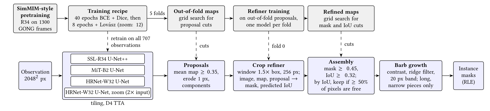

# Solar Filament Segmentation Challenge

<!-- TODO: summary -->

Solution to the [IEEE BigData Cup 2026 — Solar Filament Segmentation](https://www.kaggle.com/competitions/filament-segmentation-2026)
challenge: instance segmentation of solar filaments in GONG H-alpha full-disk observations (MAGFiLO 1.0).

## Results

| Submission | Models                                                             | Out-of-fold PQ | Public LB | s / img | Peak GPU |
|------------|--------------------------------------------------------------------|----------------|-----------|---------|----------|
| `final`    | 4 (SSL ResNet34, MiT-B2, HRNet-W32, zoom HRNet) + D4 TTA + refiner | 0.4668         | 0.40      | 10.8    | 4.0 GiB  |
| `fast`     | the same 4, flips only, + refiner                                  | 0.4642         | 0.40      | 4.1     | 4.0 GiB  |
| `lite`     | 3 (ImageNet ResNet34, MiT-B2, HRNet-W32) + refiner                 | 0.4614         | 0.39      | 2.0     | 3.9 GiB  |
| `tiny`     | HRNet-W32                                                          | 0.4508         | 0.39      | 1.2     | 1.8 GiB  |

- Out-of-fold PQ is pooled over all 707 training observations with the organizers' exact scoring
  (verified identical to `get_pq_score` from their self-evaluation notebook). It includes grown barbs, as the
  submissions do; the table under [Weights](#weights) gives it without them.
- Timing and peak GPU memory are for the full 180-image test set on an RTX 5070 Ti, including image loading.
- Annotator-vs-annotator PQ on the training set is 0.34, which bounds what the labels can support.

<!-- TODO: final-rubric metrics (mean Dice, Dice/IoU distributions, 1:n / n:1 relations) from `evaluate`. -->

## Method

<picture>
  <source media="(prefers-color-scheme: dark)" srcset="https://github.com/vhrabar/solfire/raw/paper/paper/out/pipeline-dark.png">
  
</picture>

*Pipeline of the `final` variant, dashed arrows carry training outputs into inference.*

### Data

- 707 observations, 1,154 annotation sets (up to 3 annotators per image), 2048×2048 grayscale, read as one channel
  in [0, 1] and standardised with ImageNet statistics; no contrast enhancement.
- 5-fold cross-validation grouped by observation.
- Soft targets: polygons are rasterised with pycocotools, as in the evaluator, and the annotators' masks are averaged,
  so each pixel holds the fraction of annotators who marked it.

### Models

| Member     | Decoder | Encoder   | Pretraining                                      | Input |
|------------|---------|-----------|--------------------------------------------------|-------|
| SSL-R34    | U-Net++ | ResNet34  | ImageNet, then SimMIM-style on 1,300 GONG frames | 1×    |
| MiT-B2     | U-Net   | MiT-B2    | ImageNet                                         | 1×    |
| HRNet-W32  | U-Net   | HRNet-W32 | ImageNet                                         | 1×    |
| zoom HRNet | U-Net   | HRNet-W32 | starts from the HRNet-W32 member                 | 2×    |

`lite` uses the ImageNet ResNet34 instead of SSL-R34 and drops the zoom member; `tiny` is the HRNet-W32 alone.

### Training

- 512×512 crops at native resolution, 7 per observation per epoch; with probability 0.7 a crop is placed on a
  filament vertex. Flips, quarter turns, gamma, brightness and contrast jitter.
- Base stage: 40 epochs of BCE (positive weight 5) + soft Dice, AdamW (batch 8, weight decay 0.01), peak lr 4e-4
  with the encoder at 0.25×, 3 warm-up epochs, cosine decay.
- Fine-tune: 8 epochs at lr 1e-4 with a Lovász hinge term (weight 0.5). The zoom member is fine-tuned from the base
  HRNet for 12 epochs at 2× input.
- The shipped models repeat both stages on all 707 observations and keep the final epoch (on out-of-fold maps the
  final epoch scores 0.4602 vs 0.4593 for the validation-selected one).

### Inference and post-processing

- **Ensemble:** 512 px tiles, probabilities averaged over the members; `final` uses D4 TTA with 50 % tile overlap,
  the other presets flips with 25 % overlap. fp16, dark (off-disk) tiles skipped.
- **Proposals:** threshold the mean map (0.35 in `final`), erode 1 px, split into connected components.
- **Crop refiner** (all presets but `tiny`): for each proposal, a 256 px crop of a window 1.5× its box (image,
  ensemble map, proposal) goes through a refiner network that predicts the instance mask and its IoU. It is trained
  on out-of-fold proposals; fold 0's model ships.
- **Assembly:** refined masks are thresholded (0.45) and filtered by predicted IoU (≥ 0.32), then placed in order
  of IoU; a mask is kept if at least half of its pixels are still free.
- **Barb growth:** thin, long side structures are grown from each mask using local contrast and a ridge filter
  within a 20 px band. It costs about 0.002 PQ but is the only method that adds barbs, which the organisers want.
- All cuts are grid-searched on pooled out-of-fold maps; the output is one RLE mask per instance.

### Morphology on H-alpha

<!-- TODO: qualitative examples and discus -->

### Efficiency

<!-- TODO: measured per-image inference time and peak memory; the models-vs-accuracy trade-off. -->

## What didn't work

Changes that were tested and rejected, as pooled out-of-fold PQ after calibration against a control with the same
setup. Seeds alone move a five-model set by up to 0.007 and the crop refiner by ±0.001, so a change is adopted only
if it beats its control by more than 0.002 after the full pipeline, with the nested score agreeing. None did.

| Change                             |     PQ | Control |    Gain |
|------------------------------------|-------:|--------:|--------:|
| CLAHE contrast enhancement         | 0.4367 |  0.4390 | −0.0023 |
| GONG pseudo-labels                 | 0.4353 |  0.4390 | −0.0037 |
| Lovász hinge from scratch          | 0.4446 |  0.4503 | −0.0057 |
| 1024×1024 training crops           | 0.4458 |  0.4503 | −0.0045 |
| Ensemble distillation              | 0.4465 |  0.4503 | −0.0038 |
| Tversky loss in the fine-tune      | 0.4585 |  0.4594 | −0.0009 |
| Longer fine-tune                   | 0.4589 |  0.4594 | −0.0005 |
| Thin-aware fine-tune               | 0.4599 |  0.4594 | +0.0005 |
| 35 models instead of 15            | 0.4558 |  0.4564 | −0.0006 |
| Magnetogram head, in ensemble      | 0.4550 |  0.4549 | +0.0001 |
| Watershed instance splitting       |  0.388 |   0.443 |  −0.055 |
| YOLO26m-seg member, score-ordered  | 0.4521 |  0.4641 | −0.0120 |
| Spine auxiliary head, with refiner | 0.4650 |  0.4637 | +0.0013 |
| Second refiner pass                | 0.4692 |  0.4700 | −0.0008 |
| Other refiner encoders, best       | 0.4692 |  0.4700 | −0.0008 |

Losses with clDice or differentiable morphology terms were also tried and dropped. A dedicated barb head gave no PQ
gain (best +0.0001) and barely raised thin-structure recall: it extended filament edges rather than adding barbs.

## Setup

The code is the installable Python package `solfire` (**SOL**ar **FI**lament **R**efined **E**nsemble; source in
`src/solfire/`). It requires Python 3.15.

With [uv](https://docs.astral.sh/uv/) (recommended), pick the dependency group that matches your hardware; this
installs the package in editable mode together with the pinned torch stack:

```bash
uv sync --group cuda-134   # or rocm-100 (AMD, x86_64), cpu
```
or via pip, from the repository root; this also installs `solfire` in editable mode. The same file serves every Linux setup, and the index picks the torch build:
```bash
pip install -r requirements.txt                                                               # NVIDIA CUDA
pip install -r requirements.txt --extra-index-url https://download.pytorch.org/whl/rocm10.0   # AMD ROCm (x86_64)
pip install -r requirements.txt --extra-index-url https://download.pytorch.org/whl/cpu        # CPU-only
```

`uv build` produces a wheel and sdist in `dist/`. Installing the package adds the `solfire` command
(the same CLI as `python -m solfire.main`) and `solfire-lab`, the same CLI with the dropped
experiments' options (`src/solfire/experiments/README.md`). `data/` and `runs/` are resolved against the source checkout
when the package is imported from one, otherwise against the working directory; set `FILAMENT_PROJECT_ROOT` to
override, or `FILAMENT_DATA_ROOT` to point at the data alone.

Place the competition data under `data/`:

```
data/
  train/
    MAGFiLO_1.0_Annotations_kaggle2026_train.json
    train_images/
  test/
```

## Usage

```bash
# train one fold
uv run --group cuda-134 solfire train --arch pretrained --decoder unetplusplus --encoder resnet34 --fold 0 ...

# run a sweep spec (train + calibrate every config)
uv run --group cuda-134 python scripts/sweep.py sweeps/cv5_hrnet.json --only fold

# calibrate post-processing on the pooled out-of-fold maps of several checkpoints
uv run --group cuda-134 solfire calibrate --checkpoint runs/<sweep>/*/best.pt --output runs/ensembles/<name>.calibration.json

# final-rubric metrics
uv run --group cuda-134 solfire evaluate --checkpoint ...

# predict the test set (and submit)
uv run --group cuda-134 python scripts/submit.py <checkpoints> --calibration runs/ensembles/<name>.calibration.json --no-submit
```

<!-- TODO: exact commands to reproduce the final submission from scratch+ notebook for it-->

## Weights

`weights/final/` (Git LFS) holds the shipped weights in float16 and one calibration per preset. Out-of-fold PQ is
without barbs; s/img is on an RTX 5070 Ti.

| Preset  | Models                                                             | OOF PQ | s / img | Size   |
|---------|--------------------------------------------------------------------|--------|---------|--------|
| `final` | 4 (SSL ResNet34, MiT-B2, HRNet-W32, zoom HRNet) + D4 TTA + refiner | 0.4692 | 12.9    | 303 MB |
| `fast`  | the same 4, flips only, + refiner                                  | 0.4664 | 5.1     | 303 MB |
| `lite`  | 3 (ImageNet ResNet34, MiT-B2, HRNet-W32) + refiner                 | 0.4637 | 2.7     | 230 MB |
| `tiny`  | HRNet-W32                                                          | 0.4531 | 1.5     | 73 MB  |


## Repository layout

```
src/solfire/           the package: the final method
  main.py              CLI (`solfire`): train, predict, calibrate, evaluate
  extension.py         hooks the experiments plug into
  data/                dataset, crop sampling, target rasterisation, preprocessing cache
  networks/            pretrained-encoder U-Net / U-Net++ (smp)
  training/            losses, engine, calibration, evaluation, metrics, crop refiner training
  inference/           tiling, TTA, prediction, crop refiner, barb growth, post-processing
  experiments/         every dropped experiment, still runnable with `solfire-lab` (see its README.md)
scripts/               sweeps, submission, model upload, notebook build, SSL pretraining, refiner
scripts/experiments/   data and analysis scripts of the dropped experiments
sweeps/                specs of the final method's runs (JSON)
sweeps/experiments/    specs of the dropped experiments, run through solfire-lab
tests/                 unit tests; tests/experiments/ for the experiments
```

## Tests

```bash
uv run --group cuda-134 pytest
```

## Reproducibility

- **Environment:** `uv.lock` pins every package, including the torch build per hardware group ( [Setup](#setup));
  `requirements.txt` is its export and CI checks that they agree.
- **Weights:** `weights/final/` (Git LFS) and the Kaggle models `solfire-<preset>/1` are the same fp16 files, one
  calibration JSON per preset.
- **Predicting the test set:** `notebook/Final pipeline.ipynb` (`PRESET = "final"`) loads those weights and writes the
  submission. It gives the same output as `solfire predict` on all 180 test images.
- **Determinism:** inference is not bit-exact across GPUs; masks can differ by 1–2 px at the borders, which does not
  change the score at the reported precision.
- **Retraining:** see [Usage](#usage) and `sweeps/` for the exact configurations.
- **Seeds:** every shipped model and refiner was trained with seed 1 (`--seed`, the default), which seeds `random`,
  `numpy` and `torch` (CPU and CUDA) and the augmentation and crop sampling.
- **Folds:** 5 grouped folds (all records of an observation stay together), observations shuffled by file name with
  seed 0. The assignment does not depend on `--seed`, so out-of-fold predictions of different seeds can be pooled.
- **Determinism of training:** cuDNN is not set to deterministic, so retraining with the same seed gives close but not
  identical weights (refiner runs vary by about ±0.001 PQ).
- **Training time** (NVIDIA GeForce RTX 5070 Ti): the four shipped models take about 4 h on all 707 observations
  (SSL-R34 77 min, MiT-B2 61 min, HRNet-W32 88 min, zoom HRNet 22 min), plus about 1.8 h of SSL pretraining. The 5-fold
  out-of-fold runs used for calibration and for training the refiner cost roughly 5× that per model.

## Disclaimer on the use of the LLM tools

This project was developed with the help of a LLM coding assistant,
[Claude Code](https://claude.com/claude-code), using Claude Opus 5 and 5.5 models.
It was used for:

- debugging and analysing run-time logs;
- launching and monitoring training runs and sweeps, and summarising their results;
- linguistic editing and proofreading of the documentation.

## License

- **Code:** MIT License. See [`LICENSE`](https://github.com/vhrabar/solfire/blob/main/LICENSE).
- **Model weights:**  MIT License. See [`LICENSE`](https://github.com/vhrabar/solfire/blob/main/LICENSE). 
- **Paper (text and figures):** CC BY 4.0. See [`LICENSE-paper`](https://github.com/vhrabar/solfire/blob/main/LICENSE-paper).

- **Pretraining frames:** published separately as [GONG Multi-Channel Data for Solaar Filaments](https://doi.org/10.34740/KAGGLE/DSV/21047890) under its own terms.

Copyright © 2026 Vedran Hrabar
