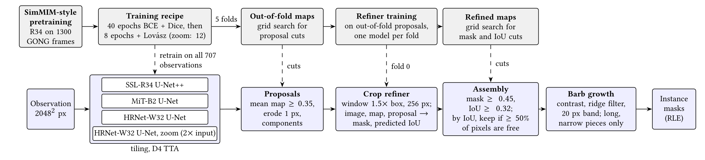
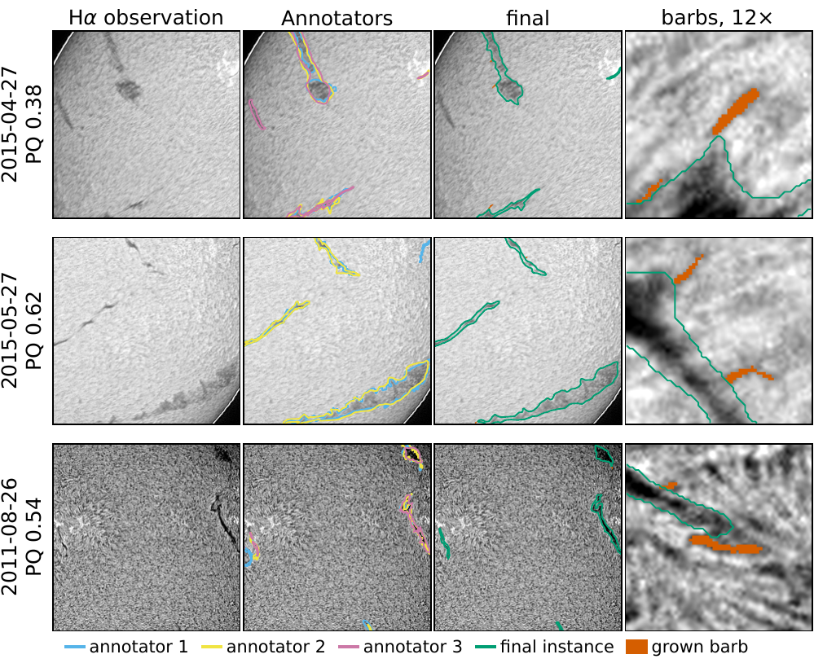

# Beyond Annotator Agreement: A Calibrated Three-Family Ensemble with Crop Refinement for Solar Filaments

**A solution to the Solar Filament Segmentation Challenge 2026**

Vedran Hrabar, Faculty of Electrical Engineering and Computing, University of Zagreb (vedran.hrabar@fer.unizg.hr)

- Competition: <https://kaggle.com/competitions/filament-segmentation-2026>
- Code and weights: <https://github.com/vhrabar/solfire>
- Unlabelled GONG pretraining frames: <https://www.kaggle.com/dsv/21047890> (doi:10.34740/KAGGLE/DSV/21047890)

This is the long form of the four-page report (`paper/main.tex`). It repeats the report's numbers and adds the detail the page limit removed: hyperparameter tables, efficiency measurements, fine-structure analysis and reproduction notes.

---

## Abstract

This report describes a solution to the Solar Filament Segmentation Challenge 2026, a Kaggle competition on automatic segmentation of solar filaments in GONG H-alpha observations.
On the training labels, one annotator scored against another reaches a Panoptic Quality (PQ) of only 0.34. Post-processing is calibrated on pooled out-of-fold maps, apart from one cut set by leaderboard probes, and each change is compared against a matching control.
In the `final` variant, four networks from three encoder families (ResNet34, MiT-B2 and HRNet-W32, the last also at twice the input resolution) produce a probability map.
A crop refiner then redraws and scores every proposal, and barbs are grown from the observation without labels.
The variant reaches an out-of-fold PQ of 0.4668 over 1154 annotation records and 0.40 on the public leaderboard.
Four released variants span 0.4508 to 0.4668 PQ at 1.2 to 10.8 s per observation.

**Keywords:** solar filaments, H-alpha, GONG, instance segmentation, panoptic quality, ensemble learning, crop refinement

## Contents

1. [Introduction](#1-introduction)
2. [Data and validation protocol](#2-data-and-validation-protocol)
3. [Methodology](#3-methodology)
   - [3.1 Preprocessing and targets](#31-preprocessing-and-targets)
   - [3.2 Models](#32-models)
   - [3.3 Training](#33-training)
   - [3.4 Inference](#34-inference)
   - [3.5 Post-processing and calibration](#35-post-processing-and-calibration)
   - [3.6 Crop refiner](#36-crop-refiner)
   - [3.7 Barb growth](#37-barb-growth)
4. [Evaluation](#4-evaluation)
   - [4.1 Released variants](#41-released-variants)
   - [4.2 Qualitative results](#42-qualitative-results)
   - [4.3 Model progression](#43-model-progression)
   - [4.4 Fine structure and barbs](#44-fine-structure-and-barbs)
   - [4.5 Efficiency](#45-efficiency)
5. [What did not work](#5-what-did-not-work)
6. [Limitations](#6-limitations)
7. [Conclusion](#7-conclusion)
8. [Reproducibility and practical notes](#8-reproducibility-and-practical-notes)
9. [Acknowledgment](#9-acknowledgment)
10. [References](#10-references)

---

## 1. Introduction

This report goes over the details of our submitted solution to the Solar Filament Segmentation Challenge 2026 [1].
The challenge, launched on July 10, 2026, is organized by the Earth-Space AI Research (ESAIR) Lab (<https://www.esairlab.com/home>).
This challenge utilizes the MAGFiLO dataset for evaluation of the segmentation algorithms [2].

The solution (code and weights: <https://github.com/vhrabar/solfire>) makes four contributions:

1. **An ensemble of three encoder families** trained on annotator-averaged targets.
2. **A crop refiner** that redraws each proposal and predicts the IoU it will earn, raising out-of-fold PQ from 0.4594 to 0.4637 on the 15-model ensemble ([Section 4.3](#43-model-progression)).
3. **A label-free barb growth step**, which adds thin barbs directly from the observation.
4. **A validation protocol** with pooled and nested scores that separates real gains from seed noise, with the rejected changes reported in [Section 5](#5-what-did-not-work).

### Overview of the pipeline



*Pipeline of the `final` variant. Dashed arrows carry training outputs into inference.*

---

## 2. Data and validation protocol

### Labels

- The training set contains **707 observations** and **1154 annotation records** (411 observations with one annotator, 145 with two, 151 with three).
- Together, these records hold **8199 filament polygons** with a median area of 1228 px.
- Thin structures under about 5 px make up 1.9 % of the annotated area.
- One annotator's set was scored against another's on the 296 observations with several records.
  This comparison gives **PQ 0.34** (SQ 0.634, RQ 0.54), and only 40 % of one annotator's thin pixels fall inside another annotator's mask.
- Most disagreement concerns whether a faint filament exists and where a long one ends.
- The 0.34 is annotator against annotator on these 296 observations. The 0.47 is the model against all 1154 records, with cuts tuned on them.
  Scored on the same 296 observations, the final model reaches 0.468 out of fold (0.470 at the shipped cuts).
  Record by record, the model scores higher against a record than the other annotators of that observation do on 82 % of the 743 records (median gain 0.12).

### Scoring

PQ [3] matches a prediction to a filament at IoU > 0.5 and computes

```
PQ = sum_{TP} IoU / ( |TP| + 1/2 |FP| + 1/2 |FN| )
```

which factors as PQ = SQ × RQ (segmentation quality times recognition quality).
Ground-truth instances are the individual polygons rasterised as COCO RLE [4], and each record is scored separately.
A false positive costs as much as a miss, so the number of instances predicted matters as much as their shape.
The evaluator used here gives the same score as the organisers' `get_pq_score` from their self-evaluation notebook (0.449043 on both, pinned by a unit test).

### Protocol

- The five folds are grouped by observation and **not separated in time**. The median out-of-fold observation lies 2.0 days from a training one and the median test observation 1.5 days, so neither score covers unseen periods.
- The score is out-of-fold (OOF) PQ, with TP, FP, FN and IoU pooled over all 1154 records as the evaluator does.
- Post-processing is calibrated on the pooled OOF maps.
- A **nested** score is also reported, with parameters chosen on four folds and applied to the fifth.
- Rerun noise is about 0.0006 on average for the three-family ensemble (from four comparisons that should have no effect) and 0.007 at most (one single-family five-model set), and ±0.001 for the refiner.
- **Adoption rule:** a change is compared with a control on the same seed and folds, and adopted only if it beats that control by more than 0.002 after the full pipeline, with the nested score agreeing.

---

## 3. Methodology

### 3.1 Preprocessing and targets

Each 2048×2048 JPEG observation is read as one greyscale channel in [0, 1] and standardised with the ImageNet [5] statistics used in encoder pretraining (mean 0.449, standard deviation 0.226 for one grey channel).
No contrast enhancement is applied ([Section 5](#5-what-did-not-work)).

Polygons are rasterised with pycocotools, as in the evaluator, and those of one annotation record are merged into a binary mask.
The target of an observation is the **mean of its record masks**, the fraction of annotators who marked each pixel.
Observations therefore carry equal weight in training, however many records they have.

### 3.2 Models

The `final` variant averages four networks from three encoder families, all built with Segmentation Models PyTorch [6]. The fourth, the zoom member, is a second HRNet-W32 U-Net that reads the observation at twice its resolution.

| # | Decoder | Encoder | Parameters |
|---|---|---|---|
| 1 | U-Net++ [7] | ResNet34 [8] (SimMIM-style pretrained) | 26.1 M |
| 2 | U-Net [9] | MiT-B2 of SegFormer [10] | 27.5 M |
| 3 | U-Net | HRNet-W32 [11] | 36.0 M |
| 4 | U-Net | HRNet-W32, the **zoom member**, reads the observation at 2× resolution | 36.0 M |

Encoders start from ImageNet weights, with the first convolution reduced to one input channel.
The four networks hold 125.5 M parameters in total.
`lite` uses the ImageNet ResNet34 instead of the SSL one and drops the zoom member, and `tiny` is the HRNet-W32 alone.

**SimMIM-style pretraining.**
In `final` and `fast`, the ResNet34 U-Net++ is first pretrained in the style of SimMIM [12] on 1300 unlabelled GONG [13] H-alpha frames from 2023-2025, which do not overlap the 2011-2022 MAGFiLO observations.

- The frames are raw FITS from the NSO archive (<https://gong2.nso.edu/HA/haf>), converted to JPEG with the MLEcoFi FITS2JPEG converter (<https://bitbucket.org/dataresearchlab/mleco-fits2jpegconvertor>) of the MAGFiLO authors' group, and kept only in bursts of five that pass brightness and dark-patch checks. They are published as [14].
- In each 512×512 crop, 60 % of the 32×32 patches are replaced by the crop mean, and the whole network learns to reconstruct them with an L1 loss on per-patch normalised targets, as in MAE [15].
- Unlike SimMIM, the network is convolutional and hidden patches take the crop mean instead of a learned token.
- After 30 epochs, the output layer is dropped and the rest initialises supervised training.

### 3.3 Training

An epoch draws seven 512×512 crops per observation at native resolution.
With probability 0.7, a crop contains a random vertex of a random filament polygon at a random position, and otherwise it is placed uniformly.
Augmentation consists of flips, quarter turns, and gamma, brightness and contrast jitter.

Models train for 40 epochs on an equally weighted sum of BCE (positive weight 5) and a soft Dice loss [16].
AdamW [17] is used with batch size 8, weight decay 0.01, and a peak learning rate of 4×10⁻⁴ (0.25× on the encoder), with three warm-up epochs and cosine decay.

A fine-tune stage of 8 epochs at 10⁻⁴ then adds a Lovász hinge [18] of weight 0.5, computed on soft targets binarised at 0.5.
The zoom member instead starts from the base HRNet and trains for 12 epochs at 2× input.

The shipped models repeat both stages on all 707 observations and keep the final epoch, as nothing is held out for selection.
A control over the fine-tune stage supports this. On OOF, the final epoch scores 0.4602 and the validation-selected epoch 0.4593.

| Hyperparameter | Base stage | Fine-tune stage |
|---|---|---|
| Epochs | 40 | 8 (zoom: 12 at 2× input) |
| Loss | BCE (pos. weight 5) + soft Dice, equal weights | same + Lovász hinge (weight 0.5) |
| Optimiser | AdamW, weight decay 0.01 | AdamW |
| Peak LR | 4×10⁻⁴ (0.25× on encoder) | 10⁻⁴ |
| Schedule | 3 warm-up epochs, cosine decay | |
| Batch size | 8 | |
| Crops per observation per epoch | 7 × 512×512, 70 % centred on a filament vertex | |

### 3.4 Inference

**Tiling.**
Models run on 512×512 windows of the full observation, the crop size of training.
The last window of each row and column is moved back to the image border to avoid padding.
Overlapping windows are blended with separable raised-cosine weights with a floor of 0.05 at the border.
Windows with no pixel above 10/255 lie off the disk. Their probability is set to zero and the model is not run on them, to save time.

**Test-time augmentation.**
The `final` variant averages all eight views of the dihedral group D4.
It does so in two passes per model, the four flips at 50 % window overlap and the four flips of the quarter-turned image at 25 %.
Other variants use the four flips at 25 % overlap.

**Zoom member.**
The zoom member sees the observation upsampled bilinearly by 2×, giving a thin filament more pixels.
Tiling is the same, and the output map is downsampled back to native resolution.
Member probability maps are averaged with equal weights.
All models run in fp16 under autocast.

### 3.5 Post-processing and calibration

The ensemble map is thresholded, grown or shrunk by a signed number of 4-connected steps, and split into 8-connected components.
Components are scored by their mean probability, and those below a minimum score or area are dropped.
A low threshold keeps a filament in one piece, and the score cut then removes uncertain ones, since under PQ a false positive costs as much as a miss.
The four parameters (threshold, offset, minimum area, minimum score) are chosen jointly for each variant by grid search on its pooled OOF maps.
The grid holds 9 thresholds from 0.25 to 0.65 (finest, in steps of 0.025, between 0.3 and 0.4), offsets from -2 to +1, minimum areas of 0, 128, 256 and 512 px, and 13 minimum scores from 0 to 0.94 (finest, in steps of 0.025, between 0.6 and 0.75), 1872 settings in all.
Components are labelled once per threshold and offset, as the area and score cuts only remove them.

Every variant settles on one step of erosion, no area cut, a threshold of 0.35 or 0.375, and a minimum score of 0.65 or 0.675.
In `tiny` this is the output.
In the other variants, the threshold and offset only cut the proposals, and the refiner sets its own cuts ([Section 3.6](#36-crop-refiner)).

### 3.6 Crop refiner

**Proposals.**
Components of at least 32 px in the thresholded, eroded map become proposals, with no score cut at this point.
A square window centred on the proposal's box, with a side of 1.5× the longer box side (at least 128 px), is cut out and resized to 256×256, to show one filament at full resolution with its surroundings.

**Refiner network.**
A ResNet34 U-Net (24.4 M parameters, ImageNet weights) reads the observation, the ensemble map and the binary proposal as three channels.
It redraws the mask of that one filament, and a head on the bottleneck predicts the IoU the mask will earn.

**Refiner training.**
- Samples are the components of the variant's pooled OOF maps at thresholds 0.3, 0.375 and 0.45. They resemble the proposals seen at test time. A proposal within IoU 0.85 of one already taken is skipped, leaving 18,840 samples for `final`.
- In each annotation record, the target is the filament that overlaps the proposal best.
- The mask loss is BCE plus soft Dice against the mean of these filaments over the records.
- The IoU head adds a BCE term of weight 0.5. Its target is the earned score, the IoU of the mask cut at 0.5 with each record's filament (zero if it does not exceed 0.5), averaged over the records.
- Training runs for 12 epochs with AdamW (batch size 32, peak learning rate 3×10⁻⁴, 0.5× on the encoder, one warm-up epoch, cosine decay).
- Augmentation is flips, transposes, and gamma and gain jitter on the observation channel.

A fold's refiner trains only on the other folds, and OOF scores use the refiner that did not see the observation.
Released variants ship the refiner of fold 0.
I did not train a refiner on all five folds. Averaging the five fold refiners did not help (their masks match the single one at foreground IoU 0.97), the expected gain is below the ±0.001 seed noise, and no held-out data could score it.

**Assembly.**
- Masks and predicted IoUs are averaged over the original window and its two flips, and each mask is resized back to native resolution, cut, and reduced to its largest component.
- Instances are painted in order of predicted IoU, and only onto free pixels.
- An instance is dropped if its predicted IoU is below the cut or less than half of its pixels are free, because two fragments of one filament are both redrawn as the whole filament.

Mask and IoU cuts are grid-searched on the refined OOF instances (7 mask cuts in [0.3, 0.6] and 31 IoU cuts in [0, 0.6]).
Shipped (mask, IoU) pairs are **0.45 and 0.32** for `final`, 0.5 and 0.32 for `fast`, and 0.45 and 0.28 for `lite`. For `final`, the IoU cut is stricter than its OOF best of 0.28 because of leaderboard probes ([Section 4.3](#43-model-progression)).
On the `final` ensemble the refiner reaches **0.4700** at its best cuts, against 0.4611 for the same proposals scored by mean probability, a gain of 0.0089. The smaller gain of 0.0043 in the progression table was measured when the refiner was first added, on the 15-model ensemble.
Using the predicted IoU alone on the unrefined masks gives 0.4632, so most of the gain comes from the redrawn masks.

### 3.7 Barb growth

Barbs are mostly unlabelled in the annotations and a dedicated head failed to learn them ([Section 5](#5-what-did-not-work)), so every variant grows them from the observation as its last step, without labels.

- The contrast of a pixel is (B - I) / B, where I is the observation and B a median over about 60 px, smoothed with a Gaussian of σ = 1.
- In a 20 px band around each instance, a pixel is a candidate if its contrast exceeds 0.05 and a Sato ridge filter [19] with σ ∈ {1, 2} exceeds 0.025.
- Only the 8-connected candidate pieces that touch the instance are considered.
- The length of a piece is the distance from its point nearest the instance to its farthest point, and its mean width is its area over this length.
- A piece is kept if its length is at least four times its mean width and that width is at most 4 px.
- Kept pixels only fill background and never take pixels from another instance.

PQ cannot select these settings, because every contrast and ridge cut tried lowers it, by 0.0006 to 0.047 before the shape filter.
As shipped, it adds 49,000 pixels over the OOF observations and moves `final` from 0.4692 to 0.4668.
I keep it because the organisers want barbs in the masks, and the additional barb score is part of the evaluation.

---

## 4. Evaluation

### 4.1 Released variants

The figures below come from the five-fold system, not from the shipped models ([Section 6](#6-limitations)).
All variants ship with barbs enabled at a cost of about 0.002 PQ.
Nested scores without barbs are 0.4655 for `fast` and 0.4628 for `lite`.
For `final`, the nested score of 0.4691 was computed with the OOF-best cut (OOF 0.4700), while the shipped cut is stricter (OOF 0.4692).

OOF quality over the 1154 records, with barbs except the "no barbs" column. Time and peak VRAM are over the 180 test observations on an NVIDIA GeForce RTX 5070 Ti.

| Variant | Models | Refiner | TTA | Time (s/img) | VRAM (GiB) | Weights (MB) | LB | PQ (barbs) | 95 % CI | PQ (no barbs) |
|---|---|---|---|---:|---:|---:|---:|---:|---:|---:|
| `final` | SSL-R34, MiT-B2, HRNet, zoom | yes | D4 | 10.8 | 4.0 | 303 | 0.40 | **0.4668** | [0.4581, 0.4758] | 0.4692 |
| `fast` | same 4 | yes | flips | 4.1 | 4.0 | 303 | 0.40 | **0.4642** | [0.4556, 0.4731] | 0.4664 |
| `lite` | R34, MiT-B2, HRNet | yes | flips | 2.0 | 3.9 | 230 | 0.39 | **0.4614** | [0.4528, 0.4705] | 0.4637 |
| `tiny` | HRNet | no | flips | 1.2 | 1.8 | 73 | 0.39 | **0.4508** | [0.4416, 0.4602] | 0.4531 |

**Confidence intervals.**
The intervals are 95 % percentile bootstraps (2000 draws, from `paper/results/preset_bootstrap.py`). Whole observations are resampled because the records of one observation are not independent.
Differences are paired on the same resampled observations: `final` beats `lite` by 0.0054 ([0.0021, 0.0086]) and `tiny` by 0.0160 ([0.0115, 0.0207]), and `fast` beats `tiny` by 0.0134 ([0.0089, 0.0182]).
The differences of `final` over `fast` (+0.0026, [−0.0005, 0.0056]) and of `fast` over `lite` (+0.0028, [−0.0003, 0.0059]) include zero, so the gains of D4 TTA and the zoom model cannot be separated from noise.
The intervals cover evaluation-set sampling only, not the seed noise (about 0.0006, at most 0.007) of each single full-data training.

**Detailed metrics.**
Dice is per record and over matched pairs.
Errors: a filament (missed) or prediction (spurious) touching nothing, a filament (split) or prediction (merged) touching two or more. Overlaps below the IoU match are in no column. Missed and split are shares of annotated filaments, spurious and merged shares of predictions.

| Variant | SQ | RQ | Dice (record) | Dice (matched) | Missed (%) | Split (%) | Spurious (%) | Merged (%) |
|---|---:|---:|---:|---:|---:|---:|---:|---:|
| `final` | 0.689 | 0.678 | 0.662 | 0.813 | 24.3 | 2.1 | 11.6 | 2.1 |
| `fast` | 0.688 | 0.675 | 0.660 | 0.812 | 22.9 | 2.6 | 12.1 | 2.0 |
| `lite` | 0.687 | 0.672 | 0.668 | 0.811 | 21.7 | 2.6 | 13.1 | 2.1 |
| `tiny` | 0.679 | 0.664 | 0.667 | 0.806 | 18.2 | 2.9 | 14.8 | 3.0 |

Reading the table:

- Moving from `tiny` to `final` raises PQ by 0.016 for a roughly nine-fold increase in inference time.
- Most of the gain comes from recognition (more correct detections, fewer spurious ones) rather than boundary quality: SQ rises 0.679 → 0.689 while RQ rises 0.664 → 0.678.
- The stronger variants miss more filaments (24.3 % vs 18.2 %) but produce fewer spurious predictions (11.6 % vs 14.8 %). The refiner and the IoU cut trade recall for precision, which is what PQ rewards.
- Merged and split errors are rare (2-3 %) in every variant, so instance separation is not the bottleneck. Whether a faint filament is annotated at all is.

### 4.2 Qualitative results

The qualitative figure (`paper/figures/qualitative.pdf`, generated by `paper/figures/qualitative.py`) shows held-out observations at the 90th, 50th and 10th percentiles of per-observation PQ among the 192 that have at least two records and four filaments per record.
Crops are 768×768 px, and annotator outlines are the union of each record's filaments.



- **90th percentile (PQ 0.59).** The instances follow the annotated outlines, and only one filament is missed across three records that hold 5 to 9 filaments each.
- **Median (PQ 0.48).** The main loss is a long filament drawn as one object (about 13,800 px). It is predicted in two pieces, and its best IoU of 0.35 counts as a miss in both records.
- **10th percentile (PQ 0.36).** The three annotators draw 9, 14 and 16 filaments on the same observation and the model misses 3, 10 and 10 of them. The score depends strongly on how many filaments a record includes.
- **Barbs.** Barb growth adds 166 px across the three crops, so the masks hold the filament bodies and just the clearest barbs.

### 4.3 Model progression

Steps of `final`, each row keeping the steps above it. Pooled OOF PQ without barbs, except the last row.

| Step | PQ | Nested | Gain |
|---|---:|---:|---:|
| ResNet34 U-Net++, base stage | 0.4390 | --- | --- |
| + Lovász fine-tune | 0.4503 | --- | +0.0113 |
| + MiT-B2 family | 0.4539 | --- | +0.0036 |
| + HRNet-W32 family | 0.4564 | 0.4548 | +0.0025 |
| Finer calibration grid | 0.4594 | 0.4564 | +0.0030 |
| + Crop refiner | 0.4637 | 0.4628 | +0.0043 |
| + Zoom member | 0.4659 | 0.4653 | +0.0022 |
| + SimMIM-style pretraining | 0.4664 | 0.4655 | +0.0005 |
| + D4 TTA, refiner retrained on its maps | 0.4700 | 0.4691 | +0.0036 |
| Shipped IoU cut 0.32 (OOF best 0.28) | 0.4692 | --- | −0.0008 |
| + Barb growth | 0.4668 | --- | −0.0024 |

Notes on the table:

- The gain of the Lovász row includes 0.007 from the extra fine-tuning alone, so the pure Lovász effect is about 0.004.
- The finer grid and the SimMIM-style pretraining fall below the adoption bar on the nested score (+0.0016 and +0.0002). I keep both because they cost nothing at inference.
- The last two rows cost PQ. The stricter cut follows leaderboard probes, which suggest that the test labels keep fewer faint filaments (0.40 at two strict cuts, 0.37 at a liberal one, 0.36 and 0.37 with fattened and thinned masks). IoU cuts of 0.28 and 0.32 both score 0.40. Barb growth costs 0.0024 and is kept because the organisers want barbs.
- A ten-model ensemble first reached 0.40 (OOF 0.4507) before any second encoder family was added. Every later model scored 0.39 or 0.40 at its calibrated cuts on the two-decimal public leaderboard, and the later steps could only be judged out of fold.

### 4.4 Fine structure and barbs

Measured on the out-of-fold maps of the three-family fine-tuned ensemble, before the zoom model and the refiner.

- Pixels thinner than about 5 px (barbs) are 1.9 % of the annotated pixels. The model's recall on them is 0.38, against 0.67 on the body of a filament.
- One annotator's thin pixels fall inside another's mask only 0.40 of the time (0.54 within 2 px), so the model is already at the level of a second annotator.
- Filling in every missed thin pixel would raise PQ by only 0.015.
- The hit rate is lowest for small, barb-heavy filaments (0.60, mean best IoU 0.45) and next lowest for the largest ones (0.62, IoU 0.49), against 0.65-0.68 and about 0.51 in between. For the largest, the problem is where a filament ends, not whether it is found.
- Chirality (left, right, unidentifiable) is read from the barbs, and annotators agree on it for 69 % of matched pairs. A straight left/right flip happens in 14 % of the left/right pairs.

### 4.5 Efficiency

Measured over the 180 test images, including image loading, on an NVIDIA GeForce RTX 5070 Ti.
The same runs on a Kaggle Tesla T4 reproduce the predictions (99.8 % of masks have IoU ≥ 0.99 against the local ones) but are 3 to 5 times slower per image.

| Preset | s / img (5070 Ti) | s / img (T4) | Peak GPU | OOF PQ (barbs) |
|---|---:|---:|---:|---:|
| `final` | 10.8 | 50.6 | 4.0 GiB | 0.4668 |
| `fast` | 4.1 | 17.7 | 4.0 GiB | 0.4642 |
| `lite` | 2.0 | 7.8 | 3.9 GiB | 0.4614 |
| `tiny` | 1.2 | 4.0 | 1.8 GiB | 0.4508 |

Accuracy is cheap at the bottom and expensive at the top.
One HRNet-W32 gets 0.4508, and three models plus the refiner add 0.0106 for 1.7× the time.
The zoom member with D4 TTA at 50 % overlap adds another 0.0054 for 5.4× the time of `lite`.
The gap between `fast` and `final` is the same four models run with D4 TTA and 50 % tile overlap instead of flips and 25 %: 2.6× the time for 0.0026 PQ.
For a Kaggle GPU session, `fast` (4.1 s per image) or `lite` (2.0 s) is the practical choice.

---

## 5. What did not work

All changes below were scored after calibration against a control with the same setup, and none passes the adoption rule of [Section 2](#2-data-and-validation-protocol).
Losses with clDice [20] or differentiable morphology terms were also tried and dropped.
A dedicated barb head gave no PQ gain (best +0.0001) and barely raised thin-structure recall, because it extended filament edges instead of adding barbs.

Rejected changes, as pooled OOF PQ against the matching control:

| Change | PQ | Control | Gain |
|---|---:|---:|---:|
| CLAHE [21] contrast enhancement | 0.4367 | 0.4390 | −0.0023 |
| GONG pseudo-labels | 0.4353 | 0.4390 | −0.0037 |
| Lovász hinge from scratch | 0.4446 | 0.4503 | −0.0057 |
| 1024×1024 training crops | 0.4458 | 0.4503 | −0.0045 |
| Ensemble distillation | 0.4465 | 0.4503 | −0.0038 |
| Tversky loss [22] in the fine-tune | 0.4585 | 0.4594 | −0.0009 |
| Longer fine-tune | 0.4589 | 0.4594 | −0.0005 |
| Thin-aware fine-tune | 0.4599 | 0.4594 | +0.0005 |
| 35 models instead of 15 | 0.4558 | 0.4564 | −0.0006 |
| Magnetogram head, in ensemble | 0.4550 | 0.4549 | +0.0001 |
| Watershed instance splitting | 0.388 | 0.443 | −0.055 |
| YOLO26m-seg [23] member, score-ordered | 0.4521 | 0.4641 | −0.0120 |
| Spine auxiliary head, with refiner | 0.4650 | 0.4637 | +0.0013 |
| Second refiner pass | 0.4692 | 0.4700 | −0.0008 |
| Other refiner encoders, best | 0.4692 | 0.4700 | −0.0008 |

Take-aways:

- **Plateau from more of the same.** Tripling the ensemble from 15 to 35 models, lengthening the fine-tune, or adding a second refiner pass all land within seed noise. The model-side lever was exhausted before the refiner was added.
- **Contrast enhancement and extra labels hurt.** CLAHE and GONG pseudo-labels both lower PQ, and a Lovász loss from scratch (without the BCE+Dice base stage) is clearly worse than using it only in the fine-tune.
- **Bigger context is not better.** 1024×1024 crops lose 0.0045 against 512×512 crops.
- **Thin structures resist.** The thin-aware fine-tune raised thin recall (0.38 → 0.43) but acted as global fattening and did not move PQ. A dedicated barb head extended edges instead of finding barbs.
- **Classical post-processing.** Watershed instance splitting is far worse (−0.055), consistent with merged and split errors being rare to begin with.
- **Different detector families.** A YOLO26m-seg member, combined score-ordered, loses 0.012.

---

## 6. Limitations

- **Validated and shipped systems differ.** All OOF scores and intervals belong to the five-fold system (models on about 80 % of the observations, one refiner per fold). The released variants are the same recipe retrained once on all 707 observations, with the final epoch kept, the refiner of fold 0, and the cuts applied unchanged. No labelled data can score them without leakage, so their quality relative to the five-fold system is not measured. Keeping the final epoch instead of the validation-selected one changed OOF PQ by +0.0009. A nested check without fold 0 was not run.
- Folds are not separated in time, so the out-of-fold scores do not cover unseen periods.
- Each configuration is one training run. The confidence intervals cover the evaluation set, not training seeds, so the order of `final`, `fast` and `lite` is not established beyond the paired differences in [Section 4.1](#41-released-variants).
- The public leaderboard is rounded to two decimals, so it cannot resolve differences below about 0.01.
- Barb growth is chosen for the barb score, not for PQ, and costs about 0.002 PQ.
- No test image or label enters any training stage. Only the IoU cut of `final` (0.32 against an OOF best of 0.28) follows leaderboard probes.
- The gap of about 0.07 between out-of-fold and leaderboard PQ is not explained. The probes point to stricter test labels for faint filaments but do not close it, so out-of-fold PQ ranks methods rather than forecasts the test score.

---

## 7. Conclusion

The `final` variant reaches an out-of-fold PQ of 0.4668 and 0.40 on the public leaderboard, and the lighter variants give up at most 0.016 PQ for inference up to nine times faster.
The crop refiner was the largest late gain, and most other changes failed the adoption rule.
Only the pooled and nested scores could show this, since a further 0.019 of OOF PQ after the first 0.40 submission left the rounded leaderboard at 0.39 to 0.40.
The gap of about 0.07 between out-of-fold and leaderboard PQ remains open.
Missed filaments (24 % of those annotated) and barbs, where annotators overlap on 40 % of thin pixels, are the most obvious places to look next.

---

## 8. Reproducibility and practical notes

- **Presets.** The code is released as the `solfire` package with four presets (`final`, `fast`, `lite`, `tiny`). Weights are fp16: 453 MB for all presets, and 303 / 303 / 230 / 73 MB per preset.
- **Predicting the test set.** `notebook/Final pipeline.ipynb` (`PRESET = "final"`) loads the released weights and writes the submission. It gives the same output as `solfire predict` on all 180 test images.
- **Reproduction.** Training and calibration follow the order of the pipeline: SimMIM-style pretraining of the ResNet34, base and fine-tune stages for each model, five-fold OOF maps, calibration grid search, refiner training on the OOF proposals, refined-map grid search, and the full-data retrain of the segmentation networks. The exact commands are in the repository README.
- **Environment.** `uv.lock` pins every package, including the torch build per hardware group.
- **Seeds.** Every shipped model and refiner was trained with seed 1, which seeds `random`, `numpy` and `torch` and the augmentation and crop sampling.
- **Folds.** Five grouped folds (all records of an observation stay together), observations shuffled by file name with seed 0. The assignment does not depend on the training seed, so OOF predictions of different seeds can be pooled.
- **Determinism.** cuDNN is not set to deterministic, so retraining with the same seed gives close but not identical weights (refiner runs vary by about ±0.001 PQ). Inference is not bit-exact across GPUs: masks can differ by 1-2 px at the borders, which does not change the score at the reported precision.
- **Training time** (RTX 5070 Ti). The four shipped models take about 4 h on all 707 observations (SSL-R34 77 min, MiT-B2 61 min, HRNet-W32 88 min, zoom HRNet 22 min), plus about 1.8 h of SSL pretraining. The five-fold OOF runs used for calibration and refiner training cost roughly 5× that per model.

---

## 9. Acknowledgment

The organization of the Filament Segmentation Challenge 2026 is partially supported by the U.S. National Science Foundation (NSF) under Grant No. 2209912 and 2433781, directorate for Computer and Information Science and Engineering (CSE), and Office of Advanced Cyberinfrastructure (OAC), and Grant No. 2511630, AST Division Of Astronomical Sciences and MPS Directorate for Mathematical and Physical Sciences.

The Filament Segmentation Challenge 2026 is sponsored by the U.S. National Science Foundation (NSF) National Solar Observatory (NSO).

This work utilizes GONG data obtained by the NSO Integrated Synoptic Program, managed by the National Solar Observatory, which is operated by the Association of Universities for Research in Astronomy (AURA), Inc. under a cooperative agreement with the National Science Foundation and with contribution from the National Oceanic and Atmospheric Administration. The GONG network of instruments is hosted by the Big Bear Solar Observatory, High Altitude Observatory, Learmonth Solar Observatory, Udaipur Solar Observatory, Instituto de Astrofísica de Canarias, and Cerro Tololo Interamerican Observatory.

## 10. References

1. A. Ahmadzadeh, D. J. Kempton, Q. Li, A. A. Pevtsov. *Solar Filament Segmentation Challenge 2026.* Kaggle, 2026. <https://kaggle.com/competitions/filament-segmentation-2026>
2. A. Ahmadzadeh, R. Adhyapak, K. Chaurasiya, L. A. Nagubandi, V. Aparna, P. C. Martens, A. Pevtsov, L. Bertello, A. Pevtsov, N. Douglas, S. McDonald, A. Bawa, E. Kang, R. Wu, D. J. Kempton, A. Abdelkarem, P. M. Copeland, S. H. Seelamneni. *A dataset of manually annotated filaments from H-alpha observations.* Nature Scientific Data 11, 1031, 2024. doi:10.1038/s41597-024-03876-y
3. A. Kirillov, K. He, R. Girshick, C. Rother, P. Dollár. *Panoptic Segmentation.* CVPR 2019, pp. 9396-9405. doi:10.1109/CVPR.2019.00963
4. T.-Y. Lin, M. Maire, S. Belongie, J. Hays, P. Perona, D. Ramanan, P. Dollár, C. L. Zitnick. *Microsoft COCO: Common Objects in Context.* ECCV 2014, LNCS 8693, pp. 740-755. doi:10.1007/978-3-319-10602-1_48
5. J. Deng, W. Dong, R. Socher, L.-J. Li, K. Li, L. Fei-Fei. *ImageNet: A Large-Scale Hierarchical Image Database.* CVPR 2009, pp. 248-255. doi:10.1109/CVPR.2009.5206848
6. P. Iakubovskii. *Segmentation Models Pytorch.* 2019. <https://github.com/qubvel/segmentation_models.pytorch>
7. Z. Zhou, M. M. Rahman Siddiquee, N. Tajbakhsh, J. Liang. *UNet++: A Nested U-Net Architecture for Medical Image Segmentation.* DLMIA/ML-CDS 2018, pp. 3-11. doi:10.1007/978-3-030-00889-5_1
8. K. He, X. Zhang, S. Ren, J. Sun. *Deep Residual Learning for Image Recognition.* CVPR 2016, pp. 770-778. doi:10.1109/CVPR.2016.90
9. O. Ronneberger, P. Fischer, T. Brox. *U-Net: Convolutional Networks for Biomedical Image Segmentation.* MICCAI 2015, pp. 234-241. doi:10.1007/978-3-319-24574-4_28
10. E. Xie, W. Wang, Z. Yu, A. Anandkumar, J. M. Alvarez, P. Luo. *SegFormer: Simple and Efficient Design for Semantic Segmentation with Transformers.* NeurIPS 34, pp. 12077-12090, 2021. arXiv:2105.15203
11. J. Wang, K. Sun, T. Cheng, B. Jiang, C. Deng, Y. Zhao, D. Liu, Y. Mu, M. Tan, X. Wang, W. Liu, B. Xiao. *Deep High-Resolution Representation Learning for Visual Recognition.* IEEE TPAMI 43(10), pp. 3349-3364, 2021. doi:10.1109/TPAMI.2020.2983686
12. Z. Xie, Z. Zhang, Y. Cao, Y. Lin, J. Bao, Z. Yao, Q. Dai, H. Hu. *SimMIM: A Simple Framework for Masked Image Modeling.* CVPR 2022, pp. 9643-9653. doi:10.1109/CVPR52688.2022.00943
13. J. W. Harvey et al. *The Global Oscillation Network Group (GONG) Project.* Science 272(5266), pp. 1284-1286, 1996. doi:10.1126/science.272.5266.1284
14. V. Hrabar. *GONG Multi-Channel Data for Solar Filaments.* Kaggle, 2026. doi:10.34740/KAGGLE/DSV/21047890. <https://www.kaggle.com/dsv/21047890>
15. K. He, X. Chen, S. Xie, Y. Li, P. Dollár, R. Girshick. *Masked Autoencoders Are Scalable Vision Learners.* CVPR 2022, pp. 15979-15988. doi:10.1109/CVPR52688.2022.01553
16. F. Milletari, N. Navab, S.-A. Ahmadi. *V-Net: Fully Convolutional Neural Networks for Volumetric Medical Image Segmentation.* 3DV 2016, pp. 565-571. doi:10.1109/3DV.2016.79
17. I. Loshchilov, F. Hutter. *Decoupled Weight Decay Regularization.* ICLR 2019. <https://arxiv.org/abs/1711.05101>
18. M. Berman, A. Rannen Triki, M. B. Blaschko. *The Lovász-Softmax Loss: A Tractable Surrogate for the Optimization of the Intersection-Over-Union Measure in Neural Networks.* CVPR 2018, pp. 4413-4421. doi:10.1109/CVPR.2018.00464
19. Y. Sato et al. *Three-dimensional multi-scale line filter for segmentation and visualization of curvilinear structures in medical images.* Medical Image Analysis 2(2), pp. 143-168, 1998. doi:10.1016/S1361-8415(98)80009-1
20. S. Shit et al. *clDice: A Novel Topology-Preserving Loss Function for Tubular Structure Segmentation.* CVPR 2021, pp. 16555-16564. doi:10.1109/CVPR46437.2021.01629
21. K. Zuiderveld. *Contrast Limited Adaptive Histogram Equalization.* In Graphics Gems IV, pp. 474-485, Academic Press, 1994.
22. S. S. M. Salehi, D. Erdogmus, A. Gholipour. *Tversky Loss Function for Image Segmentation Using 3D Fully Convolutional Deep Networks.* MLMI 2017, LNCS 10541, pp. 379-387. doi:10.1007/978-3-319-67389-9_44
23. G. Jocher, J. Qiu, M. Liu, S. Lyu, F. C. Akyon, M. E. Kalfaoglu. *Ultralytics YOLO26: Unified Real-Time End-to-End Vision Models.* arXiv:2606.03748, 2026.
